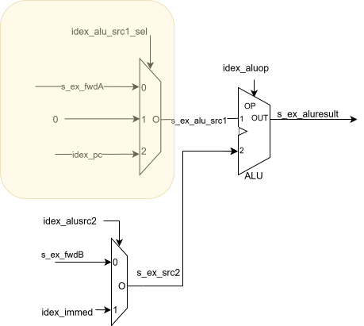
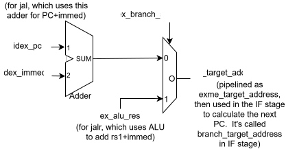
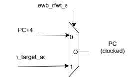
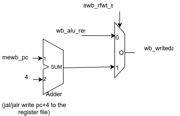
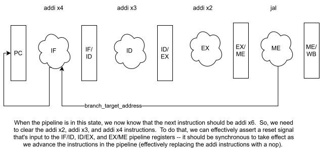

# Phase 6 - ALU and Branch Instructions

In this phase, you'll extend the design of your RISC-V CPU to include the following instructions:

* ALU (R-type) and, sub, or, xor, slt, sltu, sll, srl, sra
* ALU (I-type) andi, ori, xori, slti, sltiu, slli, srli, srai
* ALU (U-type) auipc, lui
* Unconditional Branches: jal, jalr
* Conditional Branches: beq, bne, blt, bltu, bge, bgeu

We will split this into 4 parts.  We recommend you follow this and there is a test case provided for each part.

We provide a new cpu.sv and enum_defines_pkg.sv.  For the rest, copy over your System Verilog files from Phase 5.  Each pipeline stage has some new inputs and outputs.  

The cpu.sv file we provide is the end result after all 4 parts.  We add a comment on which part the new input/output is for .  In testing, you should comment out the lines for the parts you have not reached yet. For example, below is an input to execute stage, that's needed for part 2 -- in part 1, comment this out.  

```
     .idex_alu_src1_sel(idex_alu_src1_sel), // phase 6 part 2
```

Note: you don't need to comment out the signal definitions, as they'll just be unused (you may get a warning).  But, the signal definitions can give you a good idea of how to define the inputs/output for each stage (e.g., in execute.sv, you'll need an input idex_alu_src1_sel -- you can look in how that signal is defined in cpu.sv).

But, Note: the last in the instantiation parameter list needs to not have a comma -- so you may get an error if you don't take that into account.

## Part 1: ALU (R and I-type).

We start with implementing these instructions:
* ALU (R-type) and, sub, or, xor, slt, sltu, sll, srl, sra
* ALU (I-type) andi, ori, xori, slti, sltiu, slli, srli, srai

The main modifications are 1) in the execute.sv, extend the ALU to support new ops, 2) in decode.sv, assign the control signals for these instructions.

### execute.sv

In enum_defines_pkg.sv, you'll note that we extended the alu_op_t enum to include some extra ops (e.g., ALU_AND).

In execute.sv, extend ALU's case statement (on idex_alu_op) to include each of the new ops in the alu_op_t enum.

Note: >>> in system verilog is arithmetic shift

Note: $signed function is used to re-interpret an expression as a signed value for the purpose of arithmetic and comparison operations (use for the 32 bit values that it's important if they're signed or unsigned).  May be useful for ALU_SLT and ALU_SRA.

Note: if you get this error, "sorry: constant selects in always_* processes are not currently supported (all bits will be included).", that means you can't do slicing in the always_comb block.  You probably have some code that looks like the following (under From:), which you can change to what's in Fixed: below.

```
From:               
(inside of always_comb)
   s_ex_alu_result = s_ex_fwdA << s_ex_alu_src2[4:0]; 
Fixed:
(outside of always_comb)
    logic [4:0] s_ex_alu_src2_slice40;
    assign s_ex_alu_src2_slice40 = s_ex_alu_src2[4:0];
(then inside)
    s_ex_alu_result = s_ex_fwdA << s_ex_alu_src2_slice40; // left shift
```

// TA: look for PHASE 6 PART 1. Code (a)


### decode.sv

Like did for add and addi, you need to set the control signals for the instructions we'll support here.  Your add instruction should look something like this:

```
s_id_alu_op = ALU_ADD; 
s_id_alu_src2_sel = ALU2_REG;  # (or ALU2_IMM for addi)
s_id_regwrite = 1
```

Do for R and I type instructions: and, sub, or, xor, slt, sltu, sll, srl, sra, ori, xori, slti, sltiu, slli, srli, srai
(recommend listing out on piece of paper and checking off as do each).  And you're likely going to need to add begin/end for blocks -- previously, we were just assigning instr_string, now doing 3 additional assignments.

// TA: look for PHASE 6 PART 1. Code (b)

### Testing Part 1

We provide phase6-test1.S.  You can use make_init_mem.sh to create an init.mem file that is used by the System Verilog testbench.  In the comments, we specify what the correct, expected values of each register should be.  You can run the compiled verilog (I call mine system_tb.out), and redirect the output to a file.

```
./system_tb.out > out.log
```

As a quick check, you can ```grep "Register" out.log``` to see what registers are being written to and with what values.  If there are errors, you'll need to debug with the waveforms.

You are being -- to find 2 test cases we missed (unique condition) - and why.  Put this in XXXXXX

Note: There are no new input/output ports to the stages for Part 1.


## Part 2: auipc, lui

The main new functionality needed is to enable a path for the PC to be an input to the ALU (input 1) (for the auipc instruction, which will perform pc+imm), and a constant 0 (for the lui instruction, which will perform 0+imm).  Note that the immediate for U-type is already shifted in the decode stage, with code as follows (if you don't have code like this, you can update).

```
assign s_id_immedu = $signed( {ifid_instr[31:12], {12{1'b0}}  }  ); // U-type immediate
```

Note: there's a new input to EX idex_alu_src1_sel (and output of ID idex_alu_src1_sel). cpu.sv already has that, but you'll need to add them to decode.sv and execute.sv.

Also note: in enum_defines_pkg.sv, a new enum type alu_src1_sel_t is defined (ALU1_REG, ALU1_ZERO, and ALU1_PC).


### In execute.sv

In Phase 5, the input 1 for the ALU was s_ex_alu_fwdA.  Now, we'll add a mux that selects between s_ex_alu_fwdA, 0 (zero), and idex_pc (note: we're already passing the PC as input to the EX stage).  This is illustrated below, with the new mux highlighted. 




// TA: Look for PHASE 6 PART 2. Code (a)


### In decode.sv

Here, you'll need to set the mux select line and then pipeline it in the idex pipeline register.  That is, create a new signal  ```s_id_alu_src1_sel``` (type alu_src1_sel_t defined in enum_defines_pkg.sv), then set it for the correct instruction: ALU1_REG for all other instructions, ALU1_ZERO for lui, ALU1_PC for auipc.  Be sure to assign all of the control signals:            (s_id_alu_op, s_id_alu_src1_sel, s_id_alu_src2_sel, s_id_regwrite) for each instruction.  You will also need to set s_id_alu_src1_sel (the new signal) for all other existing instructions, but you can do that above the case statement as a default.

Note: With auipc and lui -- the ALUOP is ALU_ADD -- the immediate for u type is already shifted by 12 bits (into upper bits)

Remember to register in the pipeline register:
```
   idex_alu_src1_sel <= s_id_alu_src1_sel;
```

// TA: Look for PHASE 6 PART 2. Code (b)


## Part 3a: Unconditional Branches (jal and jalr)

Recall that this is how jal and jalr work:
```
jal rd, immed   (rd=PC+4, PC=PC+immed)   

jalr rd, rs1, imm  (rd = PC+4; PC = rs1 + imm)
```

Rough outline of what we're going to need (full instructions after this list, this is just an overview):
- new mux (in EX) outputs s_ex_target_address from either brimm (for jal) or alu_result (for jalr)
   - jalr uses ALU (in EX) for rs1+imm 
   - jal uses new adder (in EX) for PC+immed  => brimm
- jal and jalr use new adder (in WB) for PC+4 (as possible value to write to rd)
- s_ex_target_address is used in IF stage (mux inputs are s_ex_target_address or PC+4)

As you go through, keep track of new control signals you're using in the stages.


### execute.sv

Main functionality is to calculate the target address to branch to.

Create new mux in EX that.  The select line idex_branch_sel (of type branch_sel_t in enum_defines_pkg.sv), input 0 is PC+imm, which is used for jal,  input 1 is s_ex_alu_result, which is used for jalr which adds rs1+immed).  output is s_ex_target_address, which gets registered as an output as exme_target_address.




Also in execute, you'll have a placeholder (anticipating the conditional branches).  Create a  new signal s_ex_alu_zero initialized to 0 (as below), and pipeline as exme_alu_zero (the always_ff block). 
```
logic s_ex_alu_zero = 0;
```

// TAs: look for PHASE 6 PART 3a. Code (a)

### mem.sv

We need to decide if we're branching or not.  Here, there's a new control signal that's used in the ME stage called exme_branchop (of type branch_op_t). 

Create a new logic block that is a function of exme_branchop and exme_alu_zero (which, for now you'll ignore exme_alu_zero, but it'll come back for conditional branches).  The output of this is setting a signal, s_pc_src (of type pc_src_t) (which, we need to make an output of mem.sv -- not pipelined).  In this logic, if exme_bracnchop == BRANCHOP_TRUE, set s_pc_src to PC_TARGET (indicating we'll want to branch and the next PC should be the calculated target address), otherwise set it to PC_PC4 (indicating we won't want to branch, and the PC should be PC+4).  Need to output s_me_pcsrc (unregistered).

// TAs: look for PHASE 6 PART 3a. Code (b)

### fetch.sv

With the target address calculated (in EX stage, and pipelined as exme_target_address), and a new control signal being set (s_me_pcsrc), we can now determine what the next PC should be.

In Phase 5, The PC is just set as PC+4.  We need to make that into a mux, select line is s_me_pcsrc, input 0 PC+4, input 1 branch_target_address.  




// TAs: look for PHASE 6 PART 3a. Code (c)

### writeback.sv

Next we need to support being able to write PC+4 to register file (for both jal and jalr).

Update the WB stage with new mux.  The select line is mewb_rfwt_sel (of type rfwt_sel_t), input 0 is mewb_alu_result, input 1 is mewb_pc+4.  Note: when we support loads, this mux will be extended to support the output of the data memory as another input, but you don't need to worry about that yet.



//  TAs: look for PHASE 6 PART 3a. Code (d)


### decode.sv

Finally, we need to set the new control signals when we're decoding the instructions.

Update in ID, setting s_branch_sel control signal, and then pipeling as output idex_branch_sel (for jal and jalr instructions).  Set a default for all other signals. 

Update in ID, setting s_rfwt_sel control signal, and then pipeling as output idex_rfwt_sel (and pipeline to exme_rfwt_sel, and mewb_rfwt_sel). Set a default for all other signals.

You also need to set a control signal, s_id_branch_op (which then gets pipelined as idex_branch_op).  You'll set to either BRANCHOP_TRUE (for jal, jalr) or BRANCHOP_FALSE (for non branch instructions).  Then in Part 4, you'll also use BRANCHOP_COND_TRUE and BRANCHOP_COND_FALSE for the conditional branch instructions based on whether the alu zero signal should be 1 or 0 to indicate the condition to branch (e.g., beq and bne will be opposite values). 

Set other control signals 
```
   s_id_alu_op = ALU_ADD; // for jalr (don't care for jal as the ALU isn't used)
   s_id_alu_src2_sel = ALU2_IMM; // for jalr (don't care for jal as the ALU isn't used)
   s_id_regwrite = 1'b1; // for both
```

// TAs: look for PHASE 6 PART 3a. Code (d)  (which is in 2 places)


### Testing

Use phase6-test3jal.S and phase6-test3jalr.S to test.  Note, we're testing before we've implemented flushing.  So, the output will technically not be correct -- but that's ok. 

You'll note that in both we have a jal/jalr instructions followed by 4 addi instructions.  Without flushing, you should see registers x2, x3, and x4 get written to (not x5) before the jal/jalr instruction takes effect, then x6 will get set.  Once you add flushing, those instructions that set x2-x4 will be flushed, so will not actually write to the registers. 

```
addi x1, x0, 1 # addr 0
jal x10, LAB   # addr 4   ( x10 should be 8 ) 
addi x2, x0, 2 # addr 8
addi x3, x0, 3 # addr 12
addi x4, x0, 4 # addr 16 (0x10)
addi x5, x0, 5 # addr 20 (0x14)

LAB: 
addi x6, x0, 6  # addr 24 (0x18)  <= only x6 should update
```

So, for the jal test, if you ```grep "Register" out.log```, you should see:

ADD OUTPUT

```
(55) Register File: Writing value 00000001 to register  1
(65) Register File: Writing value 00000008 to register 10
(75) Register File: Writing value 00000002 to register  2
(85) Register File: Writing value 00000003 to register  3
(95) Register File: Writing value 00000004 to register  4
(105) Register File: Writing value 00000006 to register  6
```


## Part 3b -- Flushing branches

For the code in our test case, the next instruction after ```jal x1, LAB should be addi x6, x0, 6```.  But, the other instructions (e.g., ```addi x2, x0, 2```) will be fetched, decoded, executed, etc because we don't know that there should be a branch until the jal instruction gets into the ME stage.  Flushing allows those other instructions work through the pipeline, and as long as we clear them before they impact the state (write the register file), no harm was done.
```
addi x1, x0, 1 # addr 0
jal x10, LAB   # addr 4   ( x10 should be 8 ) 
addi x2, x0, 2 # addr 8
addi x3, x0, 3 # addr 12
addi x4, x0, 4 # addr 16 (0x10)
addi x5, x0, 5 # addr 20 (0x14)

LAB: 
addi x6, x0, 6  # addr 24 (0x18)  <= only x6 should update
```

To understand this, consider the below illustration of the pipeline for the above code.  This shows the state when the jal instruction gets to the ME stage -- which is when we know that we'll be taking a branch (illustrated with the branch_target_address being fed back from the ME stage to the IF stage, and the IF stage calculating the next PC).  

When the pipeline is in this state, we now know that the next instruction (after jal) should be addi x6.  So, we need to clear the addi x2, addi x3, and addi x4 instructions -- so, x2, x3, and x4 don't actually get updated.  To do that, we can effectively assert a reset signal that's input to the IF/ID, ID/EX, and EX/ME pipeline registers -- it should be synchronous to take effect as we advance the instructions in the pipeline (effectively replacing the addi instructions with a nop). 



To do this takes two parts, described next.

### fetch.sv

First, we need to set the s_flush_pipeline signal in the IF stage.  When we're branching, we want to flush (set s_flush_pipeline to 1), otherwise we don't.  We know if we're branching through the s_pc_src control signal (set in the ME stage).  If it's set to PC_TARGET, that means we're branching.  So, add this code to fetch.sv: 

```
    assign s_flush_pipeline = (s_pc_src == PC_TARGET) ? 1'b1 : 1'b0; 
```

Note: This (s_flush_pipeline) is an output of the IF stage (also used internally), and input to the ID and EX stages.

### Multiple files

Next, we need to use that control signal that allows us to flush the pipeline, s_flush_pipeline.  

Part of this is we need to change the reset for flip flops to be a synchronous reset instead of asynchronous, and then also use the s_flush_pipeline as a reset signal.   

In fetch.sv, decode.sv, and execute.sv, the code is as follows (the commented code is what it was in Phase5).  Note that in fetch.sv, it's using it's own output (which you're allowed to do):

```
//    always_ff @(posedge clk or posedge reset) begin
//      if (reset) begin
    always_ff @(posedge clk) begin
        if (reset || s_flush_pipeline) begin // sync reset
```

In mem.sv the code (for the pipeline register, where it's setting mewb_* signals) should be updated as follows:

```
    always_ff @(posedge clk) begin
        if (reset) begin
```

writeback.sv does not need to be updated.

// TAs: Look in decode.sv and execute.sv to see that they changed to synchronous and use the s_flush_pipeline


### Testing

You can use the same tests from Part 3a, but this time, the output will successfully not allow those instructions to write to x2, x3, and x4.  The output will look like this (when you ```grep "Register" out.log```):

```
(55) Register File: Writing value 00000001 to register  1
(65) Register File: Writing value 00000008 to register 10
(105) Register File: Writing value 00000006 to register  6
```

## Part 4: conditional branches (beq, bne, blt, bltu, bge, bgeu)

With jal/jalr supported, we have a good start for branching.  Now we just need to add the conditional to that.  This means, we need to do a check in the EX stage, and use the output in the ME stage.

### execute.sv

Note, we previously extended the ops that the ALU supports (alu_op_t in enum_defines_pkg.sv).  Here's how we can use them for condition checks: 
* For beq and bne, we can use the ALU_SUB (alu_op_t) ALU operation for the check.  A zero result (a-b) means they are equal, otherwise not equal.
* For the blt and bge, we can use the ALU_SLT (alu_op_t) ALU operation for the check. A one result means a is less than b (by definition of set less than), and a zero result is that it's greater than or equal (i.e., not less than) 
* For the bltu and bgeu, we can use the ALU_SLTU (alu_op_t) ALU operation for the check. (same as blt/bge, just unsigned)

Here we'll use the s_ex_alu_zero (and pipelined as exme_alu_zero) signal that we created as a placeholder in Part 3.  The definition of s_ex_alu_zero is that if s_ex_alu_result==0, s_ex_alu_zero is 1, otherwise it's 0.

```
   assign s_ex_alu_zero = (s_ex_alu_result == 0) ? 1'b1 : 1'b0;
```

Note: if you don't update the signal definition to not initialize, you'll get an error: 
```
    logic s_ex_alu_zero=0;// placeholder from Part 3
    logic s_ex_alu_zero; // remove initialization for Part 4
```

// TAs: Look for PHASE 6 PART 4. Code (a)

### mem.sv

In ME stage we need to update the branch check and setting of s_pc_src.  In Part 3, it was just checking if (exme_branch_op == BRANCHOP_TRUE), and setting s_pc_src to PC_TARGET (branch_op_t) (indicating to branch and the next PC should use the calculated target address), otherwise set to PC_PC4 (indicating to not branch, and the next PC should be PC+4).  We need to extend to be condition on the exme_alu_zero signal as well.  Here, there are two additional options in the enum: BRANCHOP_COND_TRUE and BRANCHOP_COND_FALSE -- which just means it's conditional on the zero signal, and whether exme_alu_zero being 0 means branch or 1 means branch.

For example: beq, when rs1 and rs2 are equal, the s_ex_alu_result will be zero (rs1-rs2), and s_ex_alu_zero will be 1.  That's when we want to jump (so, BRANCHOP_COND_TRUE).  But, with bne, the s_ex_alu_result being zero will mean rs1 and rs2 are equal, and s_ex_alu_zero will be 1, but we don't want to jump (so, BRANCHOP_COND_FALSE).  When using ALU_SLT or ALU_SLTU, s_ex_alu_result will be 0 or 1, and how we interpret that will determine how we should jump -- you need to figure that out (come to office hours if you need help).

// TAs: Look for PHASE 6 PART 4. Code (b)


### decode.sv

In ID (decode) stage we need to set the control signals for each branch instruction.  We'll give you beq, you figure out the rest.

```
    case(opc) 
        ... other types ...
        B_TYPE: begin
            case(s_id_fun3)
                3'b000: begin // beq instruction
                    instr_string = OP_BEQ;
                    s_id_alu_op = ALU_SUB;
                    s_id_branch_sel = BRADDR_ADDR; // for branch instructions, the branch target address comes from the adder (PC + immediate)
                    s_id_rfwt_sel = RFWT_ALU; // not writing to register, so don't really care
                    s_id_branch_op = BRANCHOP_COND_TRUE; // for beq, branch when zero is 1
                    s_id_alu_src2_sel = ALU2_REG; // for beq/bne, the second ALU operand comes from the register (rs2)
                    s_id_regwrite = 1'b0; // not writing to register, so 0
                end
```

// TAs: Look for PHASE 6 PART 4. Code (c) (look at the rest of the branch instructions below BEQ)

### Testing

We provide two test files.

phase6-test4a.S -- which is a test where no branches should be taken.

phase6-test4b.S -- which is a test where every branch should be taken. 

We created such that even if flushing doesn't work, these should still work ok -- due to the added nop instructions.  

Think about which instructions should execute in each test case, and that will tell you which registers should be written to and what value.  Again, you can ```grep "Register" out.log``` to do a quick check.


## AI Use

You need to create a new file AI-use-statement.md and include a statement on how exactly you used AI (tools, prompt examples).

Note -- acceptable uses:
* Learning SystemVerilog -- e.g., provide an example of slicing in SystemVerilog.
* Code completion e.g., if I start typing something and it recognisizes a pattern, it will suggest some code to use that matches that pattern.

Note -- unacceptable uses:
* Asking it to create whole verilog code
* Proving the instructions (or code) from the assignment as asking it to complete all or part.

If in doubt, ask.  


## Submission / Grading

Add any new files you created to the git repo and commit/push all changes.  Do not include temporary files.  We include a .gitignore that should catch these, but in case it doesn't, don't add them.

Submit the URL in canvas as the submission when you are completed. 


### Rubric:

20 points total

Part 1 - 5 pt, Part 2 - 5pt, Part 3 - 5pt, Part 4 - 5pt.

We will run the test cases we provide.  For each you get correct, you will get full credit for that part (Part 3 and 4 had two tests, so half credit each).  So, you can know correctness before submission.  We will not add hidden tests.  Note: you will immediately get a 0 for the entire Phase (not just the part) if you try to game this -- like outputting some known correct output without correctly operating code.  We can easily check for this, so don't do it. 

If you get any incorrect, we'll have opportunities for partial credit.  This is where the comments (TAs: Look for...) above come in.  We'll look at the code and if you have something reasonable there, we'll give you partial credit (this is subjective, but we will have internal agreed upon guidelines for us to use but will not be explicitly sharing this).

If your System Verilog code does not compile and run without errors, you will be assigned a 0.  You will be given  and 24 hours to correct and notify the TA that let you know of the error.  Related: See Announcement for Phase 3 about the version of Icarus differences.

For AI_use_statement.md -- we are no longer giving credit, but if it does not exist we will subtract 1 point.


